# 00 - الخارطة الكلية لكتاب النكاح (الهداية للمرغيناني)

## التأصيل المنهجي لترتيب المرغيناني في «كتاب النكاح»
بنى المصنف رحمه الله **كتاب النكاح** على التسلسل العقلي الفقهي المتفرع عن **ماهية عقد النكاح** (كونه عقداً موضوعاً لملك المتعة قصداً على وجه التأبيد والخطر)، فرتب الأبواب والفصول على سبعة محاور مترابطة علّياً:
1. **الركن وألفاظ الانعقاد وشرط الشهادة:** لأن وجود العقد يتوقف أولاً على الصيغة الدالة على التمليك، وشرف المحل يقتضي إخراجه عن شبهة السفاح بالشهادة.
2. **فصل المحرمات:** لأن الصيغة المستوفية للشهادة لا تعمل إلا في **محل قابل** خالٍ عن الموانع المؤبدة (الجزئية، الاحترام) أو المؤقتة (الجمع، حق الغير).
3. **باب الأولياء والأكفاء والوكالة:** لبيان **العاقد المباشر** (الأصيل أو الولي أو الوكيل أو الفضولي) وشرط لزوم العقد دفعاً لضرر النقيصة (الكفاءة).
4. **باب المهر:** لبيان **حكم العقد وأثره المالي** الذي ثبت إبانةً لشرف المحل (وجوباً، تقرراً، تنصيفاً، أو سقوطاً).
5. **باب نكاح العبيد:** لبيان أثر **نقصان الأهلية بالرق** في العاقد والمحل والمهر.
6. **باب نكاح أهل الشرك:** لبيان أثر **اختلاف الدارين والدين** والردة والإسلام في العقود المبرمة.
7. **باب القسم:** لبيان **الحقوق المستدامة بعد تمام العقد** واستقرار الفراش (العدل في البيتوتة والصحبة).

```mermaid
flowchart TD
    classDef asl fill:#1e3a5f,stroke:#0f1f33,color:#ffffff,stroke-width:2px
    classDef zahir fill:#e8f4f8,stroke:#2b5c8f,color:#000000,stroke-width:1.5px
    classDef nadire fill:#e2e3e5,stroke:#41464b,color:#000000,stroke-dasharray: 3 3
    classDef hilaf fill:#fff3cd,stroke:#d39e00,color:#000000,stroke-dasharray: 5 5
    classDef serh fill:#f8d7da,stroke:#842029,color:#000000,stroke-width:1px

    ROOT["الأصل الكلي لكتاب النكاح:<br/>عقد مشروع لملك المتعة قصدا على التأبيد<br/>بمحل ذي خطر وشرف صيانة للنسب عن الضياع"]:::asl

    ROOT -->|"١. من حيث الصيغة وإبراز الخطر"| B1["المحور الأول: الركن وألفاظ الانعقاد والشهادة<br/>(الإيجاب والقبول واتحاد المجلس وحضور الشاهدين)"]:::zahir
    ROOT -->|"٢. من حيث قابلية المحل للعقد"| B2["المحور الثاني: فصل في بيان المحرمات<br/>(موانع المحلية المؤبدة والمؤقتة)"]:::zahir
    ROOT -->|"٣. من حيث أهلية العاقد ولزوم العقد"| B3["المحور الثالث: باب الأولياء والأكفاء<br/>(ولاية الإجبار والندب والكفاءة والفضولي)"]:::zahir
    ROOT -->|"٤. من حيث البدل المالي المترتب عليه"| B4["المحور الرابع: باب المهر<br/>(المسمى ومهر المثل والتقرر والتنصيف والنكاح الفاسد)"]:::zahir
    ROOT -->|"٥. من حيث عوارض الأهلية بالرق"| B5["المحور الخامس: باب نكاح العبيد<br/>(إذن المولى وملك اليمين الطارئ على النكاح)"]:::zahir
    ROOT -->|"٦. من حيث عوارض الدين والدار"| B6["المحور السادس: باب نكاح أهل الشرك<br/>(أنكحة الكفار وإسلام أحد الزوجين أو ردته)"]:::zahir
    ROOT -->|"٧. من حيث آثار المعاشرة المستدامة"| B7["المحور السابع: باب القسم<br/>(العدل في البيتوتة بين الزوجات ومسقطاته)"]:::zahir

    B1 -->|"لعلة إفادة ملك العين للحال"| B1_1["الانعقاد بصريح اللفظ (النكاح والتزويج)<br/>وبكنايات التمليك (الهبة والبيع والصدقة)"]:::zahir
    B1 -->|"لعلة دفع تهمة الزنا وإظهار الخطر"| B1_2["اشتراط حضور حرين أو حر وحرتين<br/>سامعين معاً كلام المتعاقدين"]:::zahir
    B1_2 -->|"نكتة الفتح والعناية"| B1_S["تحقيق ابن الهمام والبابرتي:<br/>المراد بنفي الانعقاد بدون الشهود نفي الصحة<br/>لا أصل التركيب الشرعي"]:::serh

    B2 -->|"لعلة الجزئية والاحترام"| B2_1["المحرمات المؤبدة:<br/>النسب والرضاع والمصاهرة (حتى بالزنا والمس بشهوة)"]:::zahir
    B2 -->|"لعلة إفضاء الجمع إلى القطيعة أو اختلاط النسب"| B2_2["المحرمات المؤقتة:<br/>الجمع بين المحارم أو فوق الأربع ومنكوحة الغير والمعتدة"]:::zahir
    B2_1 -->|"أصل أبي حنيفة في المحلية"| B2_S["نكتة البدائع والفتح:<br/>الوطء في نكاح المحارم عند أبي حنيفة يسقط الحد<br/>لبقاء أصل المحلية (شبهة العقد) خلافا للصاحبين"]:::serh

    B3 -->|"لعلة كمال العقل وخلوص الحق لها"| B3_1["انعقاد نكاح الحرة البالغة العاقلة بعبارتها<br/>(ظاهر الرواية عند أبي حنيفة وأبي يوسف أخيرا)"]:::zahir
    B3 -->|"لدفع ضرر العار عن الأولياء"| B3_2["اعتبار الكفاءة في ست خصال:<br/>النسب والإسلام والحرية والمال والديانة والحرفة"]:::zahir
    B3_1 -->|"رواية الحسن عن أبي حنيفة"| B3_N["عدم نفاذ العقد بغير كفء أصلا<br/>وهي المختارة للفتوى عند المتأخرين لفساد الزمان"]:::nadire

    B4 -->|"لعلة شرف المحل شرعا"| B4_1["وجوب المهر بنفس العقد الصحيح وإن لم يسم<br/>أو نفي أصلا (وتقدير أقله بعشرة دراهم)"]:::zahir
    B4 -->|"لعلة تسليم المبدل أو التمكين التام"| B4_2["تقرر المهر الكامل بالدخول أو الخلوة الصحيحة<br/>أو موت أحد الزوجين"]:::zahir
    B4 -->|"لعلة أن البضع لا يتقوم إلا بالوطء في الفاسد"| B4_3["النكاح الفاسد: لا يجب فيه المهر إلا بالوطء<br/>ويجب الأقل من المسمى ومهر المثل"]:::zahir

    B5 -->|"لعلة أن النكاح يوجب مالا في الذمة"| B5_1["توقف نكاح العبد والأمة على إذن المولى<br/>وبطلان النكاح بملك أحد الزوجين صاحبه"]:::zahir

    B6 -->|"لعلة عدم خطابهم بشرائع الفروع في حق الصحة الدنيوية"| B6_1["صحة أنكحة الكفار بلا شهود ولا عدة إن لم يعتقدوا حرمته<br/>والتفريق عند الإسلام في المحرمات عينا"]:::zahir

    B7 -->|"لعلة أن القسم من حقوق النكاح لا من موجبات الملك"| B7_1["التسوية في البيتوتة بين البكر والثيب والحرة<br/>وقسمة الحرة ضعف الأمة"]:::zahir
```

