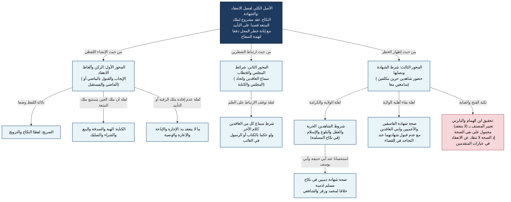

# 01_00 - شجرة فصل الانعقاد وألفاظه وشرط الشهادة

## النقد المنهجي والتأصيل الأصولي
- **نقد الفصل المدرسي الحديث بين «شروط الانعقاد» و«شروط الصحة»:** درجت الكتب المعاصرة على فصل شروط الانعقاد عن شروط الصحة في أبواب مستقلة، بينما سلك المرغيناني في **الهداية** مسلكاً تعليلياً أدق؛ إذ قرن **ركن النكاح (الإيجاب والقبول)** بـ **شرط الشهادة** في مطلع الكتاب بقوله: *(ولا ينعقد نكاح المسلمين إلا بحضور شاهدين)*، لأن الشهادة عند الحنفية وإن كانت شرط صحة وخطر لإخراج العقد عن شبهة السفاح، إلا أن العقد بدونها في حكم المعدوم شرعاً من حيث عدم ترتب آثار الصحة، ولذلك عبّر بنفي الانعقاد مجازاً عن نفي الصحة كما حققه ابن الهمام في **فتح القدير** والبابرتي في **العناية**.

