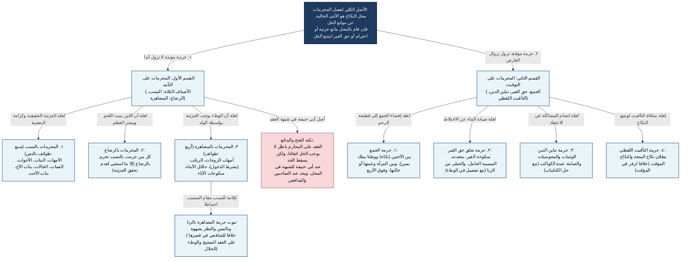

# 02_00 - شجرة فصل في بيان المحرمات

## التأصيل الأصولي لمحل العقد وموانعه في الهداية
بعد فراغ المصنف من ركن النكاح وشرط الشهادة، شرع في بيان **محل العقد (المرأة الخالية عن الموانع الشرعية)**، لأن التصرف الشرعي لا يصادف محله عند قيام المانع. وتنقسم الموانع في الفقه الحنفي بحسب علتها إلى قسمين كليين: **موانع مؤبدة** (علتها الجزئية أو الاحترام القائم مقامها)، و**موانع مؤقتة** (علتها الجمع المفضي للقطيعة، أو تعلق حق الغير، أو مانع ديني/وصفي يزول).

