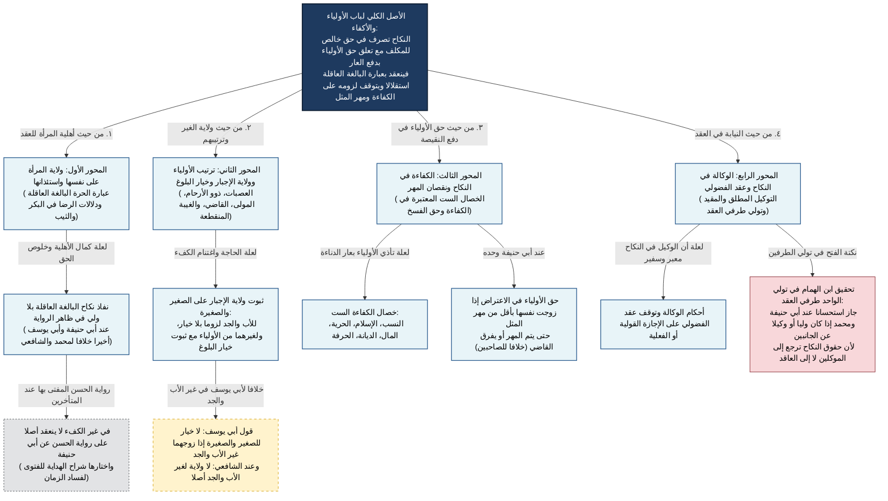

# 03_00 - شجرة باب الأولياء والأكفاء والوكالة

## التأصيل الأصولي لباب الأولياء والأكفاء في الهداية
لما فرغ المصنف من ركن العقد وشرائطه وموانع المحل، انتقل إلى بيان **من يلي مباشرة العقد (العاقد)** و**شرط لزومه في حق الأولياء (الكفاءة)**. والقاعدة الكلية عند الحنفية أن الولاية في النكاح نوعان: **ولاية ندب واستحباب** (على البالغة العاقلة)، و**ولاية إجبار وإلزام** (على الصغير والصغيرة والمجنون والمجنونة).

