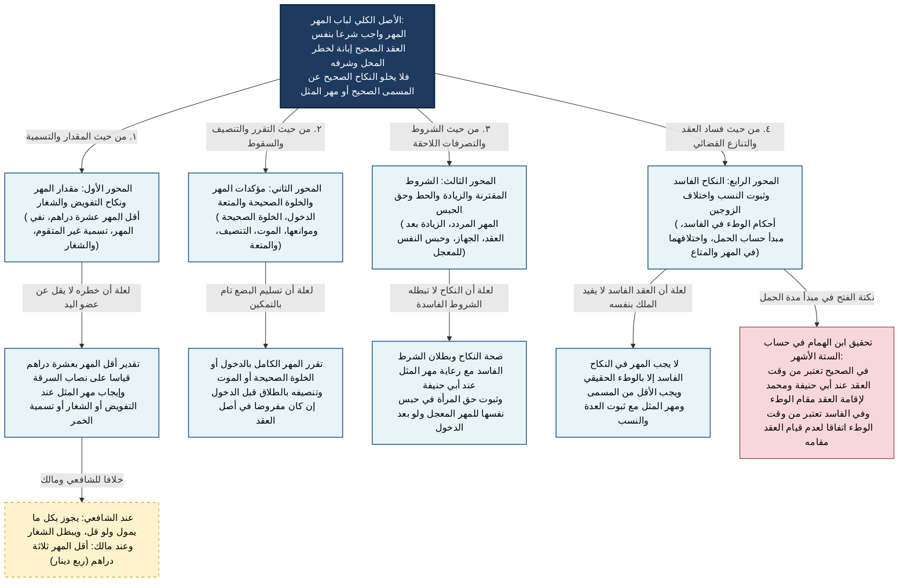

# 04_00 - شجرة باب المهر والنكاح الفاسد ومتاع البيت

## التأصيل الأصولي لباب المهر في الهداية
المهر في الفقه الحنفي **حكم من أحكام العقد الصحيح يثبت شرعاً إبانةً لشرف المحل وخطره**، وليس ركناً ولا شرطاً لانعقاده (بخلاف البدل في البيع). ومن هذا الأصل الكلي تتفرع أحكام صحته بلا تسمية، وتقدير أقله، ومؤكداته، وتنصيفه، وحكم النكاح الفاسد، ومنازعات الزوجين.

